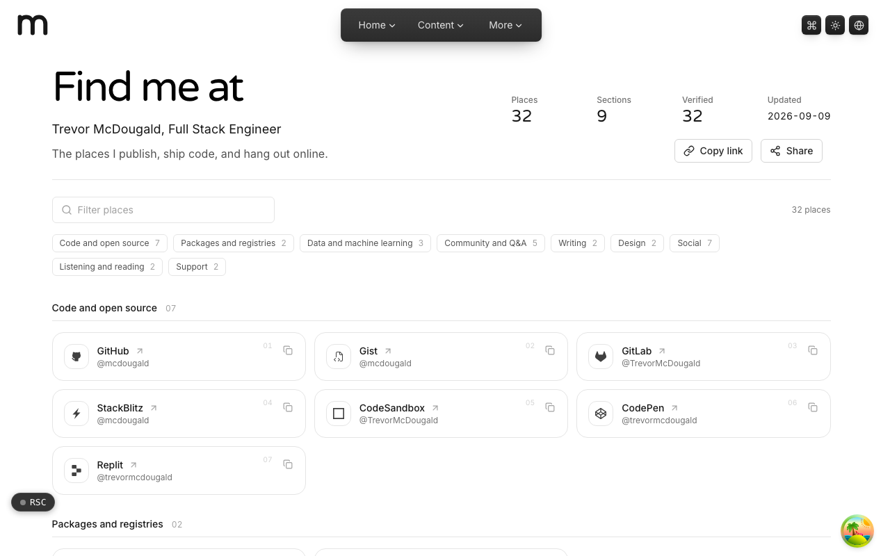
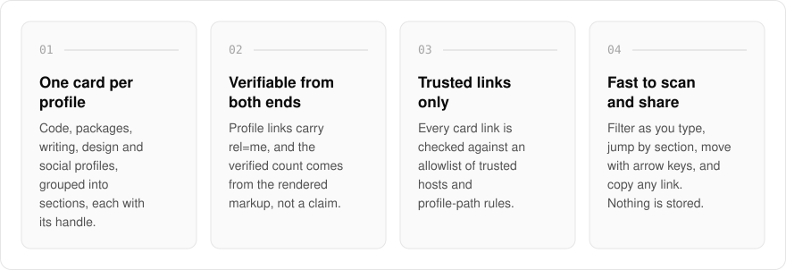
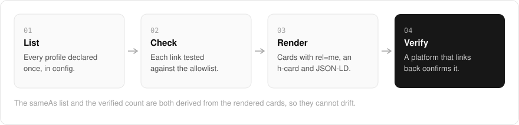

  <picture>
    <source media="(prefers-color-scheme: dark)" srcset=".github/assets/hero-dark.png">
    
  </picture>

<h1 align="center">find.me.at</h1>

<strong>Every place to find me online, in one link hub.</strong>

  
  
  

  <a href="https://find.me.at">Website</a> ·
  <a href="#features">Features</a> ·
  <a href="#how-it-works">How it works</a> ·
  <a href="#built-with">Built with</a>

A link-in-bio page asks you to take it on trust that every profile on it really belongs to the person. I built find.me.at as my own link hub: one card per place I publish, ship code, and hang out online, from GitHub and GitLab to writing, design, and social profiles. It is a small static site that states its identity claims openly with `rel="me"`, so each one can be verified from the other end.

  <picture>
    <source media="(prefers-color-scheme: dark)" srcset=".github/assets/overview-dark.svg">
    
  </picture>

## Why find.me.at

| The usual link-in-bio page | find.me.at |
| --- | --- |
| Lives on someone else's platform | A small static site on my own domain |
| Asks you to trust each link | Publishes `rel="me"` so each platform can confirm it |
| Any URL can be added | Every link checked against an allowlist of trusted hosts |
| A flat stack of buttons | Sections, a live filter, counts and keyboard navigation |

## Features

- **One card per profile**: grouped into sections such as code and open source, packages and registries, writing, design, and social, each with its handle.
- **Filter and jump**: a filter box and section chips with live counts narrow the directory as you type.
- **Verifiable identity**: outbound profile links carry `rel="me"`, so a platform that links back can confirm both ends agree. The page reports how many links are verified, derived from the rendered markup rather than asserted.
- **Structured identity data**: an `h-card` microformat and `ProfilePage` JSON-LD whose `sameAs` list is built from the rendered cards.
- **Trusted destinations only**: every card link is checked against an allowlist of trusted hosts and profile-path rules.
- **Copy and share**: copy a single profile link from its card, or copy and share the whole hub. Nothing is stored.
- **Keyboard friendly**: arrow keys move through the card grid, and every card has an explicit accessible name.

## How it works

  <picture>
    <source media="(prefers-color-scheme: dark)" srcset=".github/assets/flow-dark.svg">
    
  </picture>

Every profile is declared once in config and checked against an allowlist of trusted hosts and profile-path rules before it renders. Each card is published with `rel="me"`, and the `h-card`, the `ProfilePage` JSON-LD `sameAs` list and the verified count are all built from the rendered cards, so the claims and the page cannot disagree.

## Built with

  
  
  
  

- Next.js 16 (App Router), React 19, TypeScript
- Tailwind CSS 4
- Microformats2 (`h-card`) and schema.org JSON-LD
- next-intl

## Part of the me.at family

find.me.at is one of my [`*.me.at`](https://me.at) apps. They share one design system, account, and app shell. Development happens in a private monorepo; this repository is the project's public-facing home.

## License

Source-available. See [LICENSE](LICENSE).
